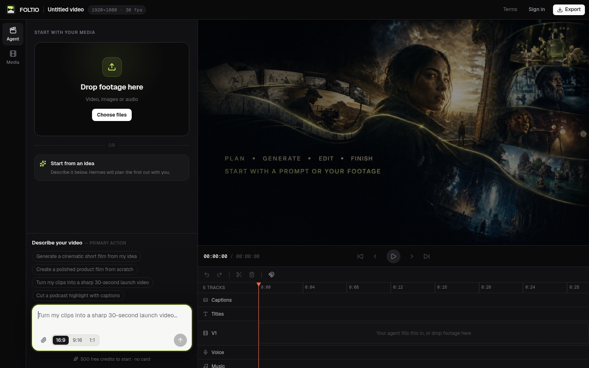
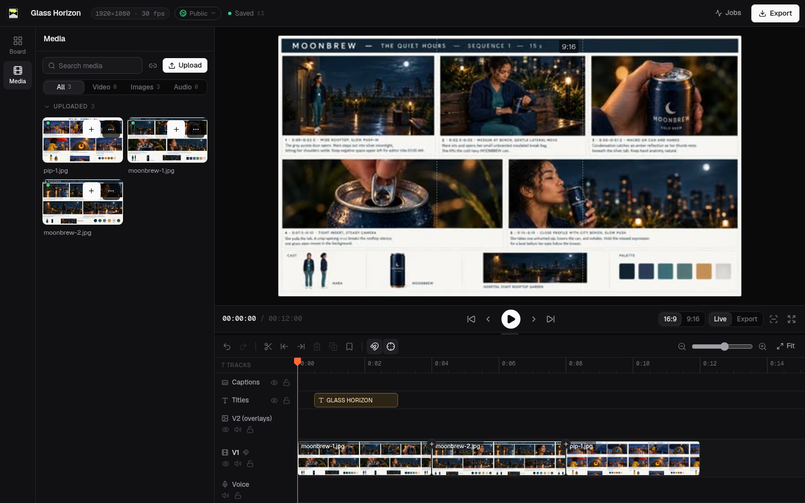

<div align="center">
  

  <h1>FOLTIO</h1>

  <p><strong>An AI studio for film.</strong></p>
  <p>Plan, generate, edit, and finish video in one open-source workspace—by hand or with an AI agent.</p>

  <p>
    <a href="https://folt.io"><strong>Try FOLTIO ↗</strong></a>
    ·
    <a href="#run-locally">Run locally</a>
    ·
    <a href="docs/ARCHITECTURE.md">Architecture</a>
    ·
    <a href="CONTRIBUTING.md">Contribute</a>
  </p>

  <p>
    <a href="https://github.com/foltio/foltio/actions/workflows/ci.yml"></a>
    <a href="LICENSE"></a>
    <a href="https://modelcontextprotocol.io"></a>
    <a href="https://github.com/foltio/foltio"></a>
  </p>
</div>



## What is FOLTIO?

FOLTIO is an open-source AI film studio that combines a nonlinear browser video editor, a media pipeline, a rendering engine, and an MCP server. A person and an AI agent can work on the same project, media library, and versioned timeline without passing files between separate tools.

Bring footage or begin with an idea. Build a cut with video, images, dialogue, music, captions, titles, and effects; preview it in the browser; then render the finished film.



## One workspace, two ways to direct

| For filmmakers | For AI agents |
| --- | --- |
| Edit on a real multitrack timeline | Read and change the same project through MCP |
| Upload footage, images, music, and dialogue | Inspect media, tracks, timings, and revisions |
| Generate optional image, video, voice, music, and sound | Apply explicit, undo-friendly operation batches |
| Preview, caption, mix, and export | Render, inspect, and iterate on the result |

Under the hood, FOLTIO includes:

- Video, audio, image, title, caption, overlay, and effects tracks
- Upload, ingest, proxy generation, frame previews, rendering, and quality checks
- Revisioned editing with optimistic concurrency and reversible operation batches
- Public-by-default projects with a one-click private setting
- An MCP interface for Claude Code, Codex, Cursor, and other compatible clients
- Optional generative media through fal; ordinary editing and rendering need no AI provider
- A local owner mode with no OAuth, analytics, billing, or hosted agent dependency

## Run locally

You need Docker Engine with Compose v2, 8 GB RAM recommended, and ports `3000`, `9000`, and `9001` available.

```bash
git clone https://github.com/foltio/foltio.git
cd foltio
cp .env.example .env
docker compose up --build
```

Open [localhost:3000](http://localhost:3000). Your projects and media are stored in named Docker volumes. `docker compose down` stops FOLTIO without deleting them; `docker compose down -v` permanently removes the local data.

> **Early release:** the self-hosted edition is ready for local evaluation, but local owner mode is not an authentication boundary. Do not expose it to an untrusted network.

For backups, networking, configuration, and updates, read the [self-hosting guide](docs/SELF_HOSTING.md).

### Connect an AI agent

Open **Settings** in FOLTIO and create an API key. The app gives you the exact MCP configuration for your installation. The endpoint is:

```text
http://localhost:3000/mcp
Authorization: Bearer sk_studio_…
```

The server publishes its editing guide at [`http://localhost:3000/skill.md`](http://localhost:3000/skill.md). MCP tools expose projects, media, generation, timeline operations, jobs, and renders using structured inputs.

### Enable generative media

Uploading, editing, and rendering work without an AI provider. To generate media, set `FAL_KEY` in `.env`, then restart the API:

```bash
docker compose up -d --force-recreate api
```

Generation can incur provider charges. Check quotes and configure account limits before starting paid jobs.

## Architecture

```text
browser / MCP client
         │
       nginx
      ┌──┴───────────────┐
 React web app       Node API + MCP
                            │
                 ┌──────────┴──────────┐
              PostgreSQL        S3 / MinIO
                                    │
                             ffmpeg + melt worker
```

PostgreSQL is the source of truth for projects, versioned timeline documents, and jobs. S3-compatible storage holds originals, proxies, frames, and renders. See [Architecture](docs/ARCHITECTURE.md) for the data model and [Development](docs/DEVELOPMENT.md) for the repository map.

## Development

```bash
npm install
cp .env.example .env.local  # edit database and storage values for your setup
npm run check
```

The public core stays deliberately cohesive: one repository for the editor, media pipeline, MCP server, and local deployment. The managed [folt.io](https://folt.io) service adds hosted infrastructure and product services outside this repository. Hosted releases consume the open-source core instead of maintaining a copied fork.

## Frequently asked questions

### Is FOLTIO an AI video generator or a video editor?

Both workflows meet in the editor. FOLTIO can organize generative image, video, voice, music, and sound jobs, but it also accepts existing footage and provides a real multitrack timeline for assembling and finishing the result.

### Can I use FOLTIO without an AI provider?

Yes. Uploading media, editing projects, creating captions and titles, and rendering video work without a generation API key. A provider key is only required for optional generative media.

### Can an AI coding agent edit video through FOLTIO?

Yes. Any compatible Model Context Protocol client can connect to FOLTIO's MCP server. The agent can inspect the project and make versioned edits while the filmmaker reviews the same timeline in the browser.

### Are projects public or private?

New projects are public by default and can be made private from the editor. On a local install, “public” means visible to anyone who can already reach that installation; it does not publish the project to folt.io.

### Is there a managed version?

Yes. [folt.io](https://folt.io) is the hosted FOLTIO experience. This repository is the self-hostable, open-source core.

## Community

Ideas, bug reports, and filmmaking workflows are welcome in [GitHub Issues](https://github.com/foltio/foltio/issues). Please read [CONTRIBUTING.md](CONTRIBUTING.md) before opening a pull request, and report vulnerabilities privately as described in [SECURITY.md](SECURITY.md).

FOLTIO is licensed under the [MIT License](LICENSE). The FOLTIO name and logo are trademarks; see [TRADEMARKS.md](TRADEMARKS.md).
